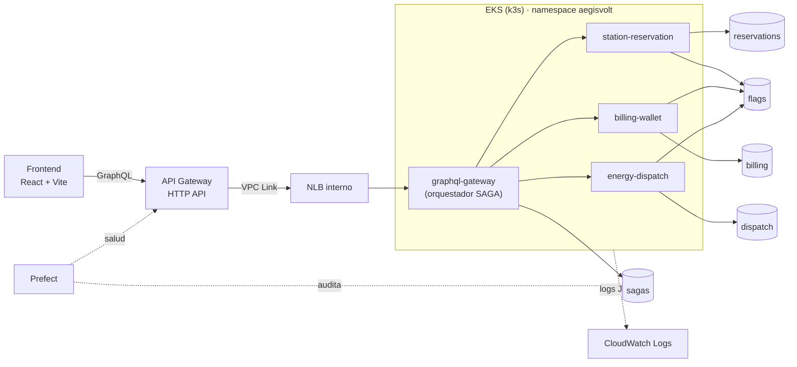

# AegisVolt

Plataforma cloud-native para que flotas eléctricas reserven, paguen y activen conectores de carga de alta potencia en una sola **transacción distribuida (SAGA)**, con tres ambientes aislados (`dev`, `test`, `prod`), despliegues canary y observabilidad de punta a punta.

Todo corre en local sobre **[Floci](https://github.com/floci-io/floci)**, un emulador de AWS: el mismo Terraform crea VPC, EKS, DynamoDB, API Gateway y CloudWatch como si fuera AWS real.



## Stack

| Capa | Tecnología |
|---|---|
| Frontend | React 19 + Vite, MapLibre (satélite Esri + OpenFreeMap, sin API keys) |
| API | GraphQL (graphql-js) detrás de API Gateway HTTP API + VPC Link + NLB |
| Microservicios | Node.js 24 + TypeScript (sin build: Node ejecuta `.ts` directo), Docker |
| Orquestación | Kubernetes (EKS emulado = k3s), Kustomize, Argo Rollouts (canary) |
| Datos | DynamoDB, una base por servicio y por ambiente |
| Infraestructura | Terraform 1.x, workspaces, state en S3 versionado |
| CI/CD | GitHub Actions con runner self-hosted, rulesets de protección |
| Observabilidad | CloudWatch Logs (JSON + `correlation_id`), Prefect 3 |

## Documentación

| Documento | Qué explica |
|---|---|
| [Arquitectura](docs/arquitectura.md) | Componentes, red (VPC, VPCE, recorrido de un paquete), datos, decisiones y atajos |
| [SAGA](docs/saga.md) | Orquestación, compensaciones, idempotencia, estados |
| [Infraestructura](docs/infraestructura.md) | Terraform, workspaces, state en S3 y cómo restaurarlo |
| [CI/CD](docs/cicd.md) | Ramas, promoción, checks, canary y rollback |
| [Observabilidad](docs/observabilidad.md) | CloudWatch, rastreo por `correlation_id`, flujos de Prefect |
| [Frontend](docs/frontend.md) | Pantallas, tiempo real y conexión a cada ambiente |
| [Operación](docs/operacion.md) | Levantar todo desde cero, después de reiniciar y problemas conocidos |
| [Guía de defensa](docs/defensa.md) | Cada pregunta del banco con su demo y comandos |

## Arranque rápido

Requisitos: Docker Desktop, Terraform ≥ 1.10, AWS CLI v2, Node ≥ 23.6, Python ≥ 3.12, `kubectl`, Git Bash (Windows).

```bash
docker compose up -d                                  # 1. Floci (AWS local) en :4566
terraform -chdir=infra/bootstrap init && terraform -chdir=infra/bootstrap apply   # 2. bucket de state + ECR
cd infra && terraform init && terraform workspace select dev && terraform apply  # 3. ambiente dev
cd .. && bash scripts/build-push.sh v1 && bash scripts/deploy.sh dev v1          # 4. imágenes + canary a EKS
cd frontend && npm install && npm run dev                                       # 5. http://localhost:5173
```

El detalle (incluido Prefect y el runner de CI) está en [Operación](docs/operacion.md).

## Estructura

```
infra/            Terraform: bootstrap (state + ECR), módulos network/dynamodb/eks/api_gateway, ci (tablas efímeras)
services/         4 microservicios TypeScript + common/ + tests (unit, integración, e2e)
k8s/              Kustomize: base (Rollouts, Services, AnalysisTemplate) + overlays por ambiente
frontend/         React + Vite
observability/    Flujo de Prefect y su self-check
scripts/          deploy, build-push, kubeconfig, recover-eks, trace-saga, chaos-orphan, runner
.github/          workflows ci.yml / deploy.yml y ruleset de protección de ramas
```
