[](#)
[](#cómo-se-aplicó-saga)
[](#schema-graphql)
[](#infraestructura-como-código)
[-FF9900.svg)](#infraestructura-como-código)
[](#canary-deployment)
[](#cicd-y-gobernanza-de-git)
[](#observabilidad)

# AegisVolt

Plataforma cloud-native para que **flotas eléctricas** reserven, paguen y activen conectores de carga de
alta potencia en una sola **transacción distribuida (SAGA)**. Tres ambientes aislados (`dev`, `test`,
`prod`), infraestructura 100 % en Terraform, despliegues canary sin caída y observabilidad de punta a punta.
Proyecto final de Patrones Arquitectónicos Avanzados. El enunciado completo está en
[`ESPECIFICACION_AEGISVOLT.md`](ESPECIFICACION_AEGISVOLT.md).

El problema no es "cargar un carro": es que **reservar, cobrar y encender el cargador viven en tres
servicios con tres bases de datos distintas**, y no hay una transacción ACID que los una. De ahí salen
las dos reglas que el sistema no puede romper nunca:

1. **No se cobra una carga que no ocurrió.** Si el cargador falla, el dinero vuelve a la flota.
2. **No queda un conector bloqueado sin uso.** Si el cobro o la activación fallan, el conector se libera.

Toda la arquitectura de este repositorio está ordenada alrededor de esas dos invariantes.

| | |
|---|---|
| **Ambientes** | `dev` · `test` · `prod`, cada uno con su VPC, su clúster EKS, sus tablas y su API Gateway |
| **Endpoint GraphQL** | `http://localhost:4566/execute-api/<api-id>/$default/graphql` (uno por ambiente) |
| **Frontend** | `http://localhost:5173` (cambia de ambiente en vivo) |
| **Prefect** | `http://127.0.0.1:4200` |

> Todo corre en local sobre **[Floci](https://github.com/floci-io/floci)**, un emulador de AWS. El mismo
> Terraform crea VPC, EKS, DynamoDB, API Gateway, ECR y CloudWatch como si fuera AWS real: sin cuenta,
> sin costo y reproducible en cualquier PC.

### Capturas

**Inicio:** presenta el producto, permite elegir el ambiente con la regla de la derecha (el punto indica
si su `/health` responde) y muestra métricas en vivo del ambiente seleccionado.

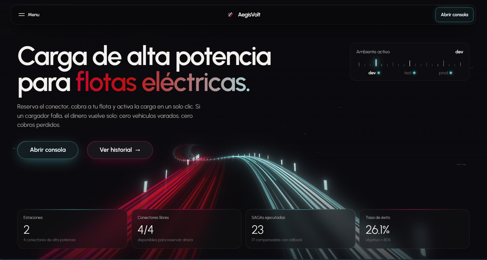

**Consola de operación:** estaciones sobre el mapa con su disponibilidad en tiempo real, conectores libres
y en uso, tasa de éxito de las SAGAs (los puntos ámbar son compensaciones), billeteras de cada flota y los
paneles de compensaciones y feature flags del ambiente activo.

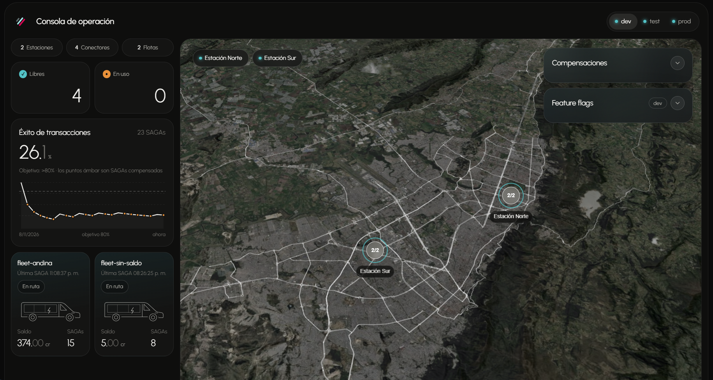

**Reservar y cargar:** al elegir una estación se escoge conector, flota y energía. El precio ya refleja las
flags del ambiente: aquí `ENABLE_DYNAMIC_SURGE_PRICING` aplica el **pico ×1.5** y
`ENABLE_FAST_CHARGE_BOOST` habilita el conector ultra de 150 kW. El botón dispara la mutación que ejecuta
la SAGA.

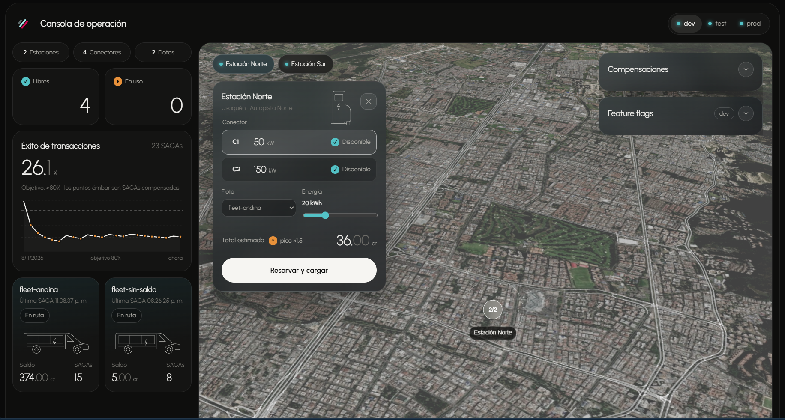

**Historial y telemetría:** cada SAGA con sus tres pasos (**R**eserva, **C**obro, **A**ctivación) coloreados
según su resultado: hecho, compensado o fallido. A la derecha, la sesión activa entregando energía.

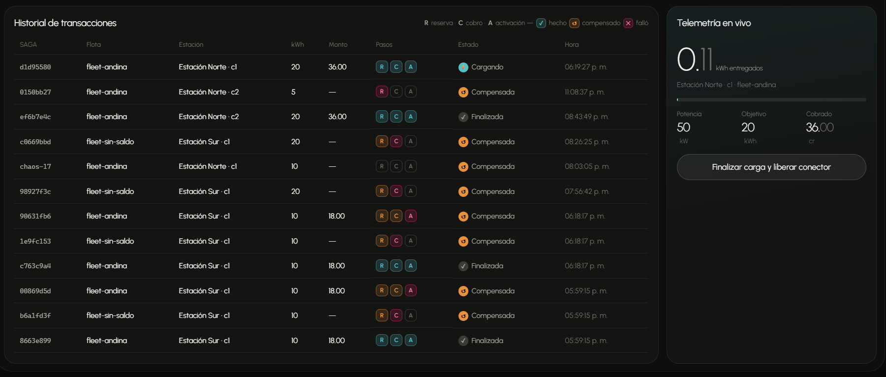

---

## Tabla de contenido

- [Arquitectura](#arquitectura)
- [Cómo se cubre la rúbrica](#cómo-se-cubre-la-rúbrica)
- [Cómo se aplicó SAGA](#cómo-se-aplicó-saga)
- [Feature flags por ambiente](#feature-flags-por-ambiente)
- [Schema GraphQL](#schema-graphql)
- [Infraestructura como código](#infraestructura-como-código)
- [CI/CD y gobernanza de Git](#cicd-y-gobernanza-de-git)
- [Observabilidad](#observabilidad)
- [Frontend](#frontend)
- [Puesta en marcha](#puesta-en-marcha)
- [Verificación](#verificación)
- [Decisiones de diseño](#decisiones-de-diseño)
- [Estructura del repositorio](#estructura-del-repositorio)
- [Documentación detallada](#documentación-detallada)

---

## Arquitectura

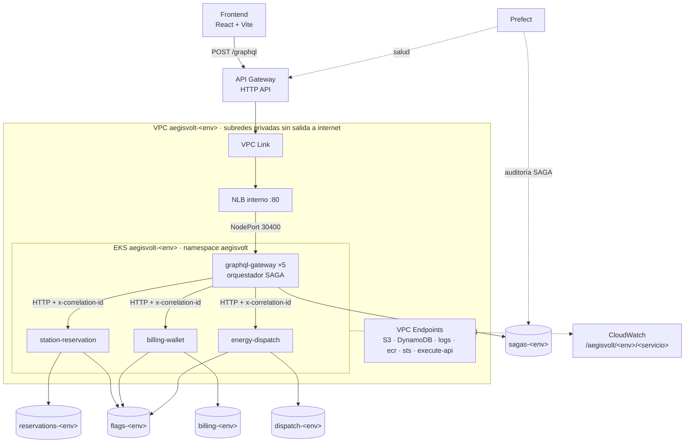

**Lo que hay que leer en el diagrama**: cada servicio escribe **solo en su tabla** (database-per-service)
y ninguno llama a otro: el único que coordina es `graphql-gateway`. Todo lo que sale de un pod hacia AWS
cruza un **VPC Endpoint**, porque las subredes privadas no tienen ruta a internet. Y el diagrama completo
existe **tres veces**, una por ambiente, sin recursos compartidos.

### Stack

| Capa | Tecnología |
|---|---|
| Frontend | React 19 + Vite, MapLibre (satélite Esri, sin API keys), Three.js para el hero |
| API | GraphQL (`graphql-js`) detrás de API Gateway HTTP API + VPC Link + NLB interno |
| Microservicios | Node.js 24 + TypeScript (Node ejecuta `.ts` directo, sin paso de build), Docker |
| Orquestación | Kubernetes (EKS, materializado por Floci como k3s), Kustomize, Argo Rollouts |
| Datos | DynamoDB, una tabla por servicio y por ambiente |
| Infraestructura | Terraform ≥ 1.10, workspaces, state remoto en S3 versionado con lock nativo |
| CI/CD | GitHub Actions con runner self-hosted, ruleset de protección de ramas |
| Observabilidad | CloudWatch Logs (JSON + `correlation_id`), Prefect 3 |

---

## Cómo se cubre la rúbrica

| Capa (peso) | Dónde se ve en este repositorio |
|---|---|
| **Infraestructura como código (30 %)** | [Workspaces](#ambientes--workspaces), [state versionado en S3](#state-remoto-en-s3-y-backups), [VPC y VPCE](#red-recorrido-de-un-paquete), [tablas DynamoDB](#dynamodb-database-per-service) |
| **CI/CD, Git y canary (25 %)** | [Ruleset](#protección-de-ramas), [promoción lineal](#promoción-entre-ambientes), [pipeline pre-merge](#pipeline-pre-merge), [apply dinámico](#pipeline-post-merge), [canary](#canary-deployment) |
| **Backend, SAGA y flags (25 %)** | [SAGA con evidencia real](#evidencia-falla-física-en-test), [idempotencia](#idempotencia), [schema GraphQL](#schema-graphql), [flags aisladas](#feature-flags-por-ambiente) |
| **Observabilidad (12 %)** | [CloudWatch por `correlation_id`](#cloudwatch-una-saga-de-punta-a-punta), [flujo de Prefect](#prefect) |
| **Presentación (8 %)** | [Las 4 funcionalidades mínimas](#frontend) |

Cada pregunta del banco de la sección 6, con su respuesta y su demo, está en la
[guía de defensa](docs/defensa.md).

---

## Cómo se aplicó SAGA

La mutación `reserveAndCharge` recorre los tres microservicios. La SAGA es **por orquestación**: un solo
componente (`graphql-gateway`) define el orden, llama a cada servicio y, si algo falla, **deshace los
pasos ya aplicados en orden inverso**.

| # | Paso | Servicio | Efecto | Compensación |
|---|---|---|---|---|
| 1 | `RESERVE` | station-reservation | conector `AVAILABLE → RESERVED` | liberar el conector |
| 2 | `CHARGE` | billing-wallet | descuenta `kWh × 1.2 cr × (surge ? 1.5 : 1)` | reembolsar el saldo |
| 3 | `ACTIVATE` | energy-dispatch | inicia la sesión `CHARGING` | (último paso: nada después que deshacer) |

### El motor en 40 líneas

[`services/graphql-gateway/saga.ts`](services/graphql-gateway/saga.ts) es genérico: no sabe de
conectores ni de billeteras, solo de pasos con `run` y `compensate`.

```ts
for (const step of steps) {
  try {
    await step.run();
    toCompensate.push(step);                       // solo se compensa lo que sí se aplicó
  } catch (e) {
    // 4xx = rechazo seguro (no se aplicó). 5xx o timeout = incierto: también se compensa ese paso,
    // lo cual es seguro porque las compensaciones son idempotentes.
    if (!(e instanceof HttpError && e.status < 500)) toCompensate.push(step);
    for (const prev of toCompensate.reverse())     // orden inverso
      await retry(prev.compensate, 3);             // 3 intentos; si no, COMPENSATION_FAILED
    return { status: 'COMPENSATED', error };
  }
}
```

### Los tres finales posibles

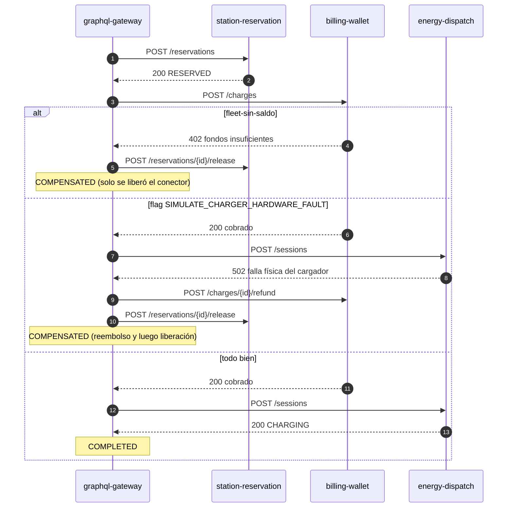

Es exactamente el flujo de compensación que pide la sección 2.3 del enunciado: si falla el paso 3 se
reembolsa y **después** se libera; si falla el paso 2 solo se libera.

### Evidencia: falla física en `test`

Es la demo 6.3 del banco de preguntas: encender la flag de falla en `test`, disparar la mutación y
mostrar en DynamoDB cómo se compensó. Ejecución real:

```graphql
mutation { reserveAndCharge(stationId: "st-sur", connectorId: "c1", fleetId: "fleet-andina", kwh: 20) {
  id status amount error steps { step status } } }
```

```json
{ "id": "c2643963-8d64-4e3b-bf26-616dfccbf4f2", "status": "COMPENSATED", "amount": 36,
  "error": "falla física del cargador st-sur/c1",
  "steps": [ { "step": "RESERVE",  "status": "DONE" },
             { "step": "CHARGE",   "status": "DONE" },
             { "step": "ACTIVATE", "status": "FAILED" },
             { "step": "CHARGE",   "status": "COMPENSATED" },
             { "step": "RESERVE",  "status": "COMPENSATED" } ] }
```

Lo que quedó en las tablas de cada servicio para esa SAGA:

```
aegisvolt-billing-test        pk = SAGA#c2643963…   sk = CHARGE   amount = 36  surge = true  23:40:27.611
                              pk = SAGA#c2643963…   sk = REFUND   amount = 36                23:40:27.783
aegisvolt-reservations-test   pk = SAGA#c2643963…   sk = RESERVE  st-sur / c1                23:40:27.526
                              pk = SAGA#c2643963…   sk = RELEASE                             23:40:27.802
```

Resultado neto: billetera de `fleet-andina` en **500 cr** (igual que antes) y `st-sur/c1` de vuelta en
`AVAILABLE`. Se cobró, se reembolsó y se liberó, en ese orden y en 400 ms.

### Idempotencia

> *"¿Cómo evita su implementación de SAGA problemas de falta de idempotencia si un mensaje o petición de
> compensación se procesa dos veces?"* (pregunta textual del banco).

Cada efecto se escribe **en la misma transacción de DynamoDB** que un marcador con
`attribute_not_exists`. Los marcadores son exactamente las filas `SAGA#<id>` de arriba:

```
TransactWriteItems [
  Update  WALLET#fleet-andina / BALANCE   SET balance = balance - :amount   IF balance >= :amount
  Put     SAGA#<id> / CHARGE              { amount, at }                    IF attribute_not_exists(pk)
]
```

| Caso | Qué pasa |
|---|---|
| Primera vez | Ambas escrituras se aplican juntas, o ninguna |
| Petición duplicada | El `Put` del marcador falla, la transacción entera se cancela y el saldo **no** se toca. El servicio lee el marcador y devuelve el resultado original |
| Regla de negocio violada | La transacción falla pero el marcador no existe: es un error real (402 sin fondos, 409 conector ocupado) |

Aplica igual a `RESERVE`/`RELEASE`, `CHARGE`/`REFUND` y `SESSION`. Lo implementa `idempotent()` en
[`services/common/index.ts`](services/common/index.ts) y lo prueban los tests de integración (doble
reserva, doble cobro) y el e2e (reembolso repetido).

### Estados de una SAGA

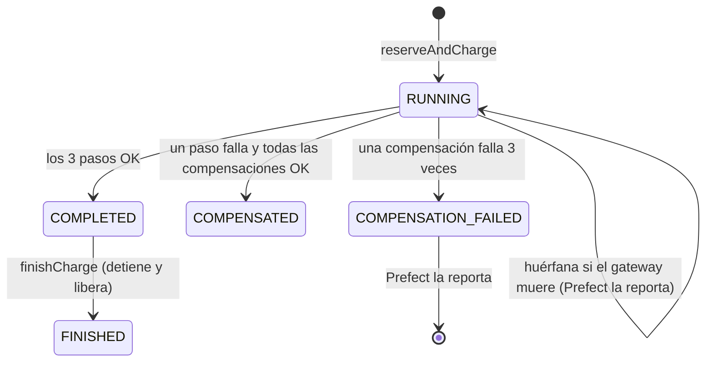

Los dos estados de la parte de abajo son los que el sistema **no** puede resolver solo. Para eso existe el
[flujo de Prefect](#prefect): los detecta y pone el flujo en rojo.

Más detalle en [`docs/saga.md`](docs/saga.md).

---

## Feature flags por ambiente

Sistema propio sobre DynamoDB: **una tabla por ambiente** (`aegisvolt-flags-dev`, `-test`, `-prod`).

| Flag | dev | test | prod | Efecto |
|---|---|---|---|---|
| `ENABLE_DYNAMIC_SURGE_PRICING` | on | on | **off** | Cobra ×1.5 el kWh en hora pico |
| `ENABLE_FAST_CHARGE_BOOST` | on | on | **off** | Permite reservar conectores ultra de 150 kW |
| `SIMULATE_CHARGER_HARDWARE_FAULT` | off | off | off | El cargador falla al activar: fuerza la compensación |

<sub>Valores iniciales que siembra Terraform. Después se cambian en caliente desde el frontend.</sub>

### Cómo llegan al comportamiento

```ts
// services/common/index.ts — se lee en cada uso, sin caché
export async function flag(name: string): Promise<boolean> {
  return (await getItem(table('flags'), { name }))?.enabled === true;
}
```

- **Las lee el servicio que las aplica, en cada petición.** `billing-wallet` consulta
  `ENABLE_DYNAMIC_SURGE_PRICING` al cobrar; `station-reservation` rechaza con **403** un conector ultra si
  `ENABLE_FAST_CHARGE_BOOST` está apagada; `energy-dispatch` responde **502** si la falla está simulada.
- **No hay caché ni redespliegue.** Cambiar el switch escribe en la tabla y la siguiente petición ya ve el
  valor nuevo.
- **El aislamiento es físico, no lógico.** Cada servicio lee la tabla con el sufijo de *su* ambiente
  (`APP_ENV`, inyectado por el overlay de Kustomize). Un pod de `dev` no tiene forma de leer la tabla de
  `prod`.
- **Terraform no pisa lo cambiado en caliente.** Las semillas usan `ignore_changes = [item]`.

El frontend no decide nada: la interfaz bloquea el conector ultra y muestra el aviso de precio pico, pero
la regla vive en el backend. Si alguien llama la API saltándose la interfaz, recibe el mismo 403.

---

## Schema GraphQL

Un único esquema en `graphql-gateway`, la capa de agregación que pide el enunciado.

```graphql
type Query {
  env: String!                  # ambiente que atiende (dev | test | prod)
  stations: [Station!]!         # estaciones y estado de cada conector
  flags: [Flag!]!               # feature flags de este ambiente
  wallet(fleetId: ID!): Wallet
  sagas: [Saga!]!               # historial con pasos y compensaciones
  saga(id: ID!): Saga
  telemetry(sagaId: ID!): Telemetry
}

type Mutation {
  reserveAndCharge(stationId: ID!, connectorId: ID!, fleetId: ID!, kwh: Float!): Saga!   # dispara la SAGA
  finishCharge(sagaId: ID!): Saga!                                                       # fin normal de la carga
  setFlag(name: String!, enabled: Boolean!): Flag!                                       # cambio en caliente
}
```

Las *queries* consultan estaciones, telemetría e historial; las *mutations* inician la reserva, el cobro y
la sesión de carga. `Saga.steps` es la bitácora completa (cada `DONE`, `FAILED` y `COMPENSATED` con hora y
error): de ahí se dibuja el historial del frontend.

El pipeline **compila el esquema** y `schema.test.ts` verifica que exponga exactamente estas 7 queries y
3 mutations: si alguien rompe el contrato que consume la interfaz, el PR no se puede mergear.

---

## Infraestructura como código

Nada se crea a mano. El provider `aws` apunta a Floci (`http://localhost:4566`).

```
infra/
├── bootstrap/       bucket aegisvolt-tfstate (versionado) + repos ECR. Se aplica una sola vez
├── main.tf          workspace guard, módulos y log groups
└── modules/
    ├── network/     VPC, subredes, tablas de rutas, IGW, VPC endpoints
    ├── dynamodb/    5 tablas por ambiente + semillas (conectores, billeteras, flags)
    ├── eks/         clúster en subredes privadas, endpoint solo privado
    └── api_gateway/ NLB interno, target group, VPC Link, HTTP API, rutas y stage
```

### Ambientes = workspaces

Todo recurso toma su nombre de `terraform.workspace`:

| | dev | test | prod |
|---|---|---|---|
| VPC | `10.10.0.0/16` | `10.20.0.0/16` | `10.30.0.0/16` |
| Tablas | `aegisvolt-*-dev` | `aegisvolt-*-test` | `aegisvolt-*-prod` |
| Clúster / API | `aegisvolt-dev` | `aegisvolt-test` | `aegisvolt-prod` |
| Logs | `/aegisvolt/dev/*` | `/aegisvolt/test/*` | `/aegisvolt/prod/*` |
| State en S3 | `env:/dev/aegisvolt.tfstate` | `env:/test/aegisvolt.tfstate` | `env:/prod/aegisvolt.tfstate` |

> **¿Por qué un `apply` en `test` no puede pisar `prod`?** Cada workspace tiene **su propio archivo de
> state**, y Terraform solo modifica los recursos registrados en el state activo. Como además todos los
> nombres llevan el ambiente, no existe un recurso compartido que pueda colisionar. Y un `precondition`
> (`workspace_guard`) aborta cualquier `apply` desde un workspace que no sea `dev`, `test` o `prod`.

### State remoto en S3 y backups

```hcl
backend "s3" {
  bucket       = "aegisvolt-tfstate"   # Versioning: Enabled + prevent_destroy
  key          = "aegisvolt.tfstate"   # con workspaces queda env:/<ws>/aegisvolt.tfstate
  use_lockfile = true                  # lock nativo en S3: dos apply del mismo ambiente no se pisan
}
```

Estado real del bucket:

```
$ aws s3api get-bucket-versioning --bucket aegisvolt-tfstate
{ "Status": "Enabled" }

$ aws s3api list-objects-v2 --bucket aegisvolt-tfstate --query 'Contents[].Key'
env:/dev/aegisvolt.tfstate    env:/prod/aegisvolt.tfstate    env:/test/aegisvolt.tfstate

$ aws s3api list-object-versions --bucket aegisvolt-tfstate --prefix env:/dev/aegisvolt.tfstate
| 1d0e0b16-84b6-4575-adf7-6ba453203a5b | 2026-11-09T02:08:39+00:00 | True  |
| df144afb-5707-4685-b396-9c74fcf392a9 | 2026-11-09T00:25:58+00:00 | False |
| 6f33b031-aa93-450e-9fd6-6f21b26c51bf | 2026-11-08T21:31:54+00:00 | False |
| …                                    | 29 versiones en total     |       |
```

**Restaurar un state corrupto** sin perder nada: se copia la versión buena sobre sí misma. Pasa a ser la
más reciente y la corrupta queda como una versión más del historial.

```bash
aws s3api copy-object --bucket aegisvolt-tfstate --key env:/dev/aegisvolt.tfstate \
  --copy-source "aegisvolt-tfstate/env:/dev/aegisvolt.tfstate?versionId=<VersionId bueno>"
terraform workspace select dev && terraform plan     # debe mostrar solo diferencias reales
```

### Red: recorrido de un paquete

Cada VPC tiene dos subredes públicas y dos privadas. Las **privadas no tienen ruta por defecto**: ni NAT
ni internet. El clúster y el NLB viven ahí.

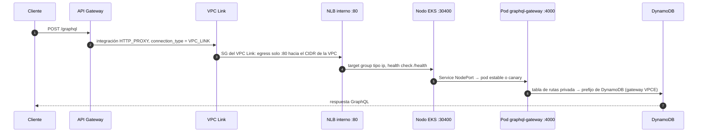

| VPC Endpoint | Tipo | Para qué |
|---|---|---|
| S3, DynamoDB | Gateway | Agregan los prefijos del servicio a la tabla de rutas privada |
| `logs`, `execute-api`, `ecr.api`, `ecr.dkr`, `sts` | Interface | ENI privada por subred con DNS privado, SG que solo admite 443 desde el CIDR de la VPC |

### DynamoDB: database-per-service

```
aegisvolt-reservations-dev   aegisvolt-billing-dev   aegisvolt-dispatch-dev   aegisvolt-sagas-dev   aegisvolt-flags-dev
aegisvolt-reservations-test  aegisvolt-billing-test  aegisvolt-dispatch-test  aegisvolt-sagas-test  aegisvolt-flags-test
aegisvolt-reservations-prod  aegisvolt-billing-prod  aegisvolt-dispatch-prod  aegisvolt-sagas-prod  aegisvolt-flags-prod
```

| Tabla | Dueño | Contenido |
|---|---|---|
| `reservations` | station-reservation | Conectores (`status`, `powerKw`, `ultra`) + marcadores `RESERVE` / `RELEASE` |
| `billing` | billing-wallet | Billeteras de flota + marcadores `CHARGE` / `REFUND` |
| `dispatch` | energy-dispatch | Sesiones de carga y telemetría |
| `sagas` | graphql-gateway | Bitácora de cada SAGA: estado, pasos, monto, error |
| `flags` | (lectura de todos) | Estado de las feature flags del ambiente |

Más detalle en [`docs/infraestructura.md`](docs/infraestructura.md) y
[`docs/arquitectura.md`](docs/arquitectura.md).

---

## CI/CD y gobernanza de Git

### Promoción entre ambientes

```mermaid
gitGraph
  commit id: "base"
  branch dev
  checkout dev
  branch feature/frontend
  checkout feature/frontend
  commit id: "trabajo"
  checkout dev
  merge feature/frontend id: "PR → dev · deploy dev"
  branch test
  checkout test
  merge dev id: "PR dev → test · deploy test"
  branch prod
  checkout prod
  merge test id: "PR test → prod · deploy prod"
```

Cadena estrictamente lineal, siempre por PR. El job `promotion-check` rechaza cualquier otro origen:

| Destino | Origen permitido |
|---|---|
| `dev` | una rama `feature/*` (nunca `test` ni `prod`: no se promueve hacia atrás) |
| `test` | solo `dev` |
| `prod` | solo `test` |

Así se ve en el repositorio: cada cambio sube `dev → test → prod` con su CI y su despliegue en verde.

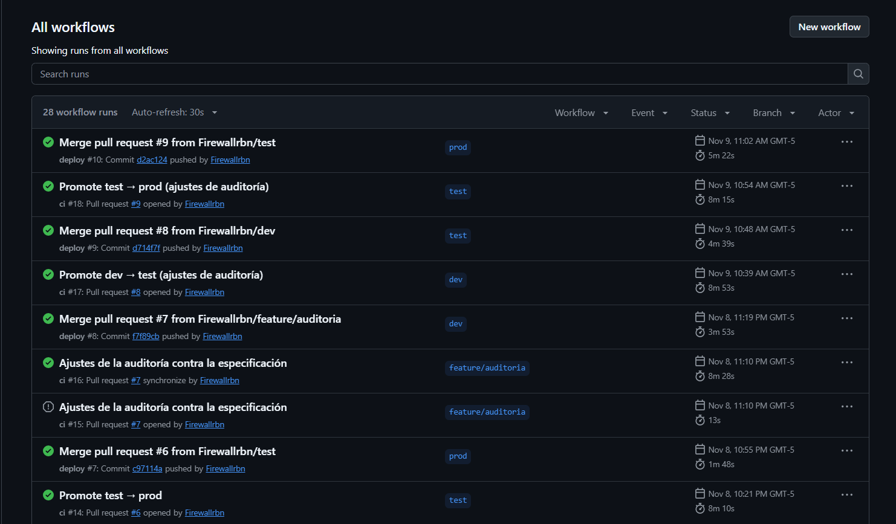

### Protección de ramas

Ruleset `proteger-ambientes` ([`.github/rulesets/ambientes.json`](.github/rulesets/ambientes.json)) sobre
`dev`, `test` y `prod`, **sin excepciones** (`bypass_actors: []`: ni el dueño del repo puede saltarlo).

| Regla | Efecto |
|---|---|
| `non_fast_forward` | Prohíbe `git push --force` |
| `pull_request` | Prohíbe el push directo: todo entra por PR |
| `required_status_checks` | Los 6 checks deben estar en verde para habilitar el merge |
| `deletion` | Prohíbe borrar la rama |

```text
$ git push origin feature/x:test
remote: - Changes must be made through a pull request.
remote: - 6 of 6 required status checks are expected.
 ! [remote rejected] feature/x -> test (push declined due to repository rule violations)
```

### Pipeline pre-merge

[`.github/workflows/ci.yml`](.github/workflows/ci.yml), en cada PR hacia `dev`, `test` o `prod`:

| Job | Qué valida |
|---|---|
| `promotion-check` | Que el origen del PR sea el permitido para ese destino |
| `lint-build` | `tsc`, esquema GraphQL, build del frontend, `terraform fmt/validate`, las 4 imágenes Docker |
| `unit-tests` | Motor SAGA (camino feliz, fallas, orden de compensación, timeout) y esquema GraphQL |
| `integration-tests` | Los 4 servicios contra tablas DynamoDB efímeras `*-ci`: idempotencia real, 402, 409 y flags en vivo |
| `e2e-tests` | La SAGA completa por GraphQL: feliz, sin fondos, falla física e idempotencia del reembolso |
| `terraform-plan` | `terraform plan` en el workspace de la **rama destino** (`github.base_ref`), con el resumen en el run |

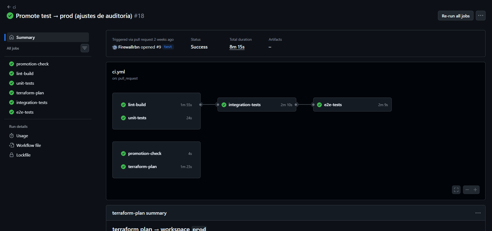

Las tablas `*-ci` las crea el **mismo módulo** `dynamodb` de Terraform y se destruyen al final, aunque la
prueba falle: el CI nunca toca datos de `dev`, `test` ni `prod`.

### Pipeline post-merge

[`.github/workflows/deploy.yml`](.github/workflows/deploy.yml). **La rama decide el ambiente**:

```yaml
env:
  ENVIRONMENT: ${{ github.ref_name }}     # dev | test | prod: la rama que recibió el merge
steps:
  - run: |
      terraform workspace select "$ENVIRONMENT"
      terraform apply -auto-approve -input=false -lock-timeout=120s
```

Después, `canary-deploy` despliega a Kubernetes. Un detalle importante: el tag de imagen es
`git rev-parse --short=12 HEAD:services`, el **hash del contenido** de `services/`. Al promover a `test` o
`prod` el árbol es idéntico, así que se despliega **exactamente la misma imagen ya probada en `dev`**, sin
reconstruir.

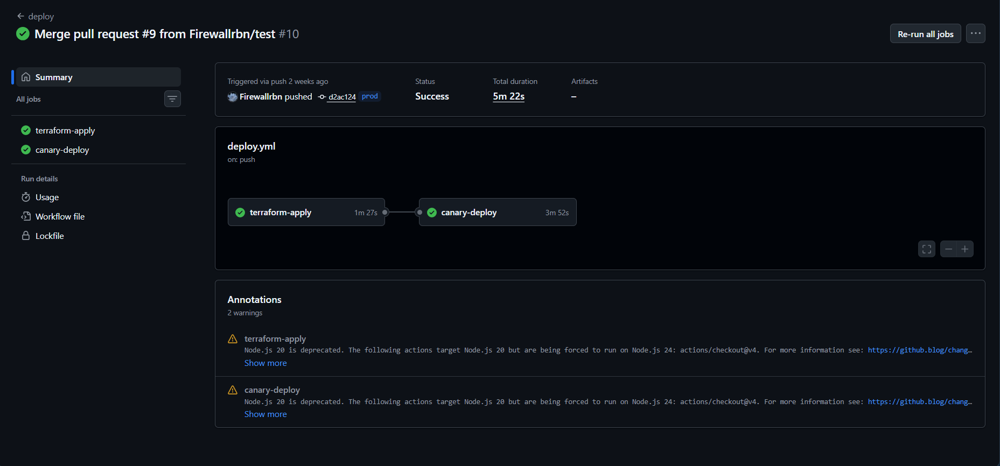

### Canary deployment

Cada servicio es un `Rollout` de Argo Rollouts:

```yaml
strategy:
  canary:
    canaryService: graphql-gateway-canary
    steps:
      - setWeight: 20                                  # 1 de 5 réplicas con la versión nueva
      - analysis: { templates: [{ templateName: canary-health }] }
progressDeadlineSeconds: 90
progressDeadlineAbort: true
```

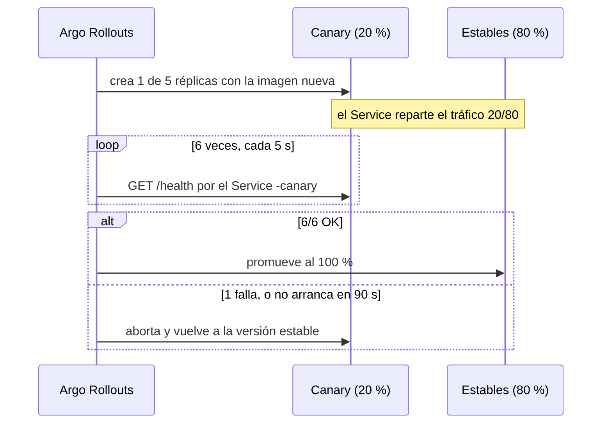

**Métrica de promoción** (`AnalysisTemplate canary-health`): 6 consultas a `/health` de los pods canary,
`successCondition: result.ok == true` y `failureLimit: 0`. Un solo fallo aborta. Salida real:

```
[graphql-gateway] canary OK, promovido al 100%
[station-reservation] canary OK, promovido al 100%
[billing-wallet] canary OK, promovido al 100%
[energy-dispatch] canary OK, promovido al 100%
OK [prod] 0f2c2b2345bd -> GraphQL: http://localhost:4566/execute-api/5615f050a9/$default/graphql
```

```
$ kubectl -n aegisvolt get rollouts
NAME                  DESIRED   CURRENT   UP-TO-DATE   AVAILABLE
billing-wallet        1         1         1            1
energy-dispatch       1         1         1            1
graphql-gateway       5         5         5            5
station-reservation   1         1         1            1
```

### Runner self-hosted

El CI necesita llegar a Floci y al Docker local, así que corre en un runner propio con la etiqueta
`aegisvolt`.

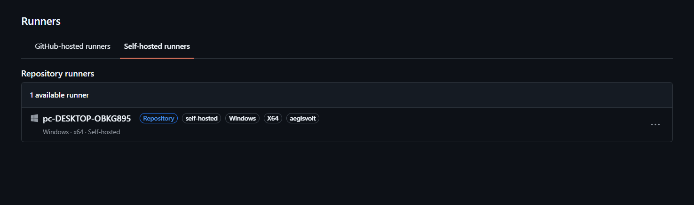

Más detalle en [`docs/cicd.md`](docs/cicd.md).

---

## Observabilidad

### CloudWatch: una SAGA de punta a punta

Cada línea de log es un JSON con ambiente, servicio y el `correlation_id`, que es el id de la SAGA. Viaja
en el header `x-correlation-id` entre servicios. Los grupos los crea Terraform, uno por ambiente y servicio:

```
/aegisvolt/dev/graphql-gateway    /aegisvolt/test/graphql-gateway    /aegisvolt/prod/graphql-gateway
/aegisvolt/dev/billing-wallet     /aegisvolt/test/billing-wallet     /aegisvolt/prod/billing-wallet
…                                 …                                  …
```

Rastreo real de la SAGA fallida de [la evidencia de arriba](#evidencia-falla-física-en-test), juntando los
cuatro grupos de `test` en orden de tiempo:

```
$ bash scripts/trace-saga.sh test c2643963-8d64-4e3b-bf26-616dfccbf4f2
23:40:27.417  info   graphql-gateway      SAGA iniciada                         fleet-andina · st-sur/c1 · 20 kWh
23:40:27.558  info   station-reservation  conector reservado                    st-sur/c1
23:40:27.634  info   billing-wallet       cobro realizado                       amount 36 · surge true
23:40:27.759  error  energy-dispatch      falla física del cargador             st-sur/c1
23:40:27.762  error  energy-dispatch      falla física del cargador st-sur/c1   status 502 · /sessions
23:40:27.789  info   billing-wallet       reembolso realizado                   amount 36
23:40:27.806  info   station-reservation  conector liberado
23:40:27.815  warn   graphql-gateway      SAGA COMPENSATED
```

<sub>Salida resumida en columnas; cada línea original es un JSON con `timestamp`, `level`, `env`,
`service`, `msg` y `correlation_id`.</sub>

### Prefect

El flujo [`aegisvolt-observabilidad`](observability/flow.py) supervisa los tres ambientes a la vez:

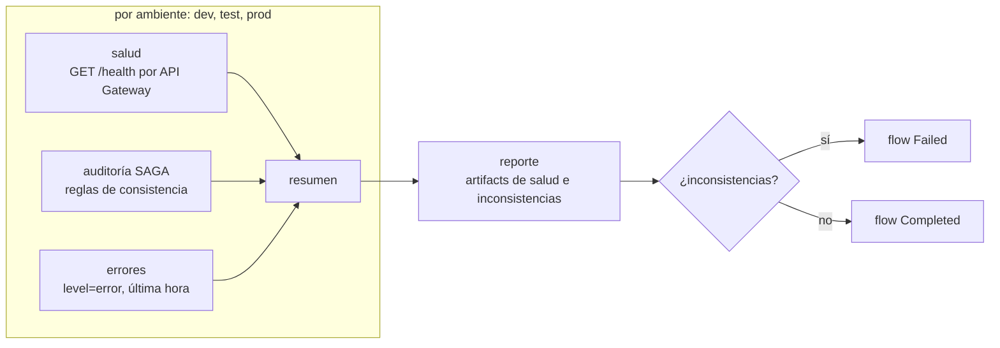

| Inconsistencia que audita | Cómo se detecta |
|---|---|
| SAGA huérfana | `RUNNING` hace más de 2 minutos (una SAGA real tarda menos de 1 s: el orquestador murió a mitad) |
| Compensación fallida | Estado `COMPENSATION_FAILED` |
| Cobro sin reembolso | SAGA compensada con marcador `CHARGE` y sin `REFUND` |
| Conector bloqueado | Conector `RESERVED` cuya SAGA no está `RUNNING` ni `COMPLETED` |

Un ambiente caído se reporta como `DOWN`, pero **no** pone el flujo en rojo: solo lo hacen las
inconsistencias de datos, que son las que requieren acción humana.

**Demo de una huérfana:** `chaos-orphan.sh` simula un orquestador que murió a mitad de una SAGA. El flujo
la detecta y queda en rojo; al limpiarla, vuelve a verde.

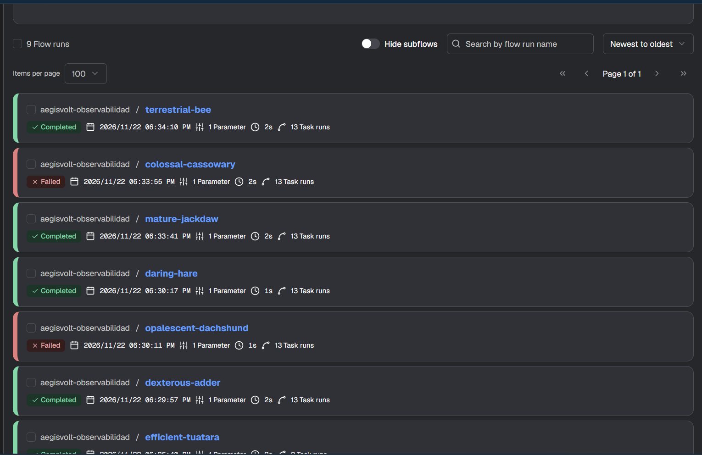

El artifact `aegisvolt-salud` resume cada ejecución: salud y latencia de cada ambiente, SAGAs por estado,
inconsistencias y errores de la última hora.

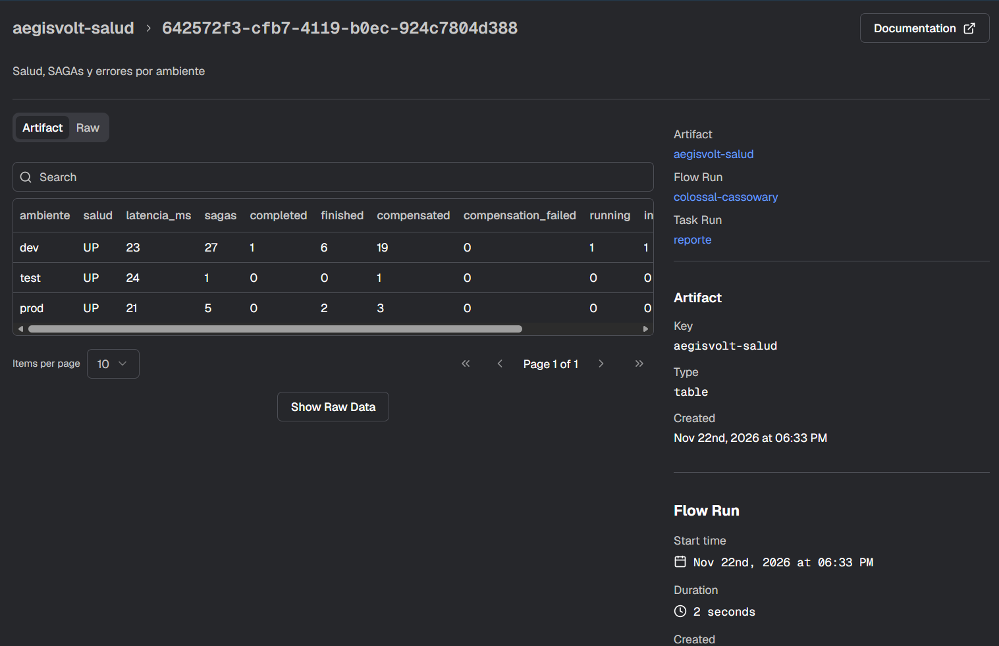

Las reglas de auditoría son una función pura (`find_inconsistencies`) con su propio self-check:
`python observability/test_flow.py` → `ok: 4 inconsistencias detectadas, 0 falsos positivos`.

Más detalle en [`docs/observabilidad.md`](docs/observabilidad.md).

---

## Frontend

Las cuatro funcionalidades mínimas de la sección 2.1, todas sobre el endpoint GraphQL del ambiente elegido:

| Funcionalidad pedida | Dónde está |
|---|---|
| Estado de electrolineras y conectores en tiempo real | Mapa con anillo de estado por estación, contadores de libres / en uso y métricas del hero |
| Flujo de reserva y activación (dispara la SAGA) | Panel **Reservar y cargar**: muestra la línea de tiempo de la SAGA al terminar |
| Feature flags activas según el ambiente | Panel **Feature flags**: switches que escriben en la tabla del ambiente seleccionado |
| Historial y estado de compensaciones | **Historial** (pasos R·C·A por SAGA) y panel **Compensaciones** con cada acción revertida, numerada en el orden en que se ejecutó |

- **Un selector, tres ambientes.** Al arrancar, `vite.config.ts` lista las APIs de Floci y arma un proxy por
  ambiente (`/gw/dev`, `/gw/test`, `/gw/prod`). El tablero completo cambia de ambiente sin recargar.
- **Tiempo real por polling:** estado completo cada 2 s, salud de los tres ambientes cada 5 s y telemetría
  de la sesión activa cada 1.5 s.
- **Cada estado lleva ícono y texto**, nunca solo color.

Más detalle en [`docs/frontend.md`](docs/frontend.md).

---

## Puesta en marcha

### Requisitos

Docker Desktop, Terraform ≥ 1.10, AWS CLI v2, Node.js ≥ 23.6, Python ≥ 3.12, `kubectl` y Git Bash (en
Windows).

```bash
export AWS_ENDPOINT_URL=http://localhost:4566 AWS_ACCESS_KEY_ID=test AWS_SECRET_ACCESS_KEY=test \
       AWS_DEFAULT_REGION=us-east-1 AWS_PAGER="" MSYS_NO_PATHCONV=1
```

### Desde cero

| # | Paso | Comando |
|---|---|---|
| 1 | Floci (AWS local en `:4566`) | `docker compose up -d` y `bash scripts/verify-floci.sh` (22 chequeos) |
| 2 | Bucket de state + ECR | `terraform -chdir=infra/bootstrap init && terraform -chdir=infra/bootstrap apply` |
| 3 | Workspaces | `cd infra && terraform init && for e in dev test prod; do terraform workspace new $e; done` |
| 4 | Infra de un ambiente | `terraform workspace select dev && terraform apply` |
| 5 | Imágenes | `bash scripts/build-push.sh $(git rev-parse --short=12 HEAD:services)` |
| 6 | Despliegue canary | `bash scripts/deploy.sh dev <tag>` (instala Argo Rollouts si falta) |
| 7 | Frontend | `cd frontend && npm install && npm run dev` → http://localhost:5173 |
| 8 | Prefect | `cd observability && .venv/Scripts/prefect server start` → http://127.0.0.1:4200 |
| 9 | Runner de CI | `powershell -File scripts/start-runner.ps1` |

En el día a día, los pasos 4 a 6 los hace el pipeline al mergear un PR.

> **RAM:** cada clúster k3s usa ~1.2 GB. En un PC de 16 GB conviene tener uno o dos ambientes encendidos a
> la vez: `docker stop floci-aws-eks-aegisvolt-test` lo apaga (la infra y los datos quedan) y
> `bash scripts/recover-eks.sh test` lo vuelve a levantar.

### Scripts

| Script | Qué hace |
|---|---|
| `verify-floci.sh` | 22 chequeos de que Floci emula todo lo que el proyecto usa |
| `kubeconfig.sh <env>` | kubeconfig del clúster de ese ambiente |
| `recover-eks.sh [envs]` | Recrea el clúster si su contenedor no corre |
| `build-push.sh <tag>` | Construye y sube las 4 imágenes a ECR |
| `deploy.sh <env> <tag>` | Canary de los 4 servicios, espera el resultado y registra el nodo en el NLB |
| `trace-saga.sh <env> <id>` | Logs de una SAGA en CloudWatch, en orden |
| `chaos-orphan.sh <env> [--clean]` | Crea o limpia una SAGA huérfana simulada |

Reinicios, RAM y problemas conocidos: [`docs/operacion.md`](docs/operacion.md).

---

## Verificación

| Nivel | Archivo | Pruebas | Qué cubre |
|---|---|---|---|
| Unit | `graphql-gateway/saga.test.ts` | 5 | Camino feliz, falla en paso 2, falla en paso 3 con orden de compensación, timeout que compensa el paso incierto, `COMPENSATION_FAILED` |
| Unit | `graphql-gateway/schema.test.ts` | 1 | El esquema compila y expone lo que consume la UI |
| Integración | `integration/services.int.ts` | 5 | Contra DynamoDB real: reserva doble, 409, cobro doble, 402, flag leída en vivo |
| E2E | `e2e/saga.e2e.ts` | 3 | Por GraphQL: feliz + `finishCharge`, flota sin saldo, falla física + reembolso idempotente |
| Auditoría | `observability/test_flow.py` | 1 | Las 4 reglas de inconsistencia sin falsos positivos |

```bash
cd services
npm test             # unit
npm run integration  # requiere las tablas *-ci y los servicios levantados (lo hace el CI)
npm run e2e
```

---

## Decisiones de diseño

| Decisión | Por qué |
|---|---|
| **SAGA por orquestación**, no coreografía | Un solo lugar define el orden y las compensaciones. Con coreografía, entender "qué pasa si falla el cobro" exige leer tres servicios; aquí está en una lista de pasos. La bitácora en `sagas` hace la auditoría trivial |
| **Compensar también el paso incierto** (5xx o timeout) | Un timeout no dice si el efecto ocurrió. Compensarlo es seguro porque las compensaciones son idempotentes y no hacen nada si no hubo efecto |
| **Idempotencia con marcador en la misma transacción** | El marcador y el efecto se escriben juntos o no se escriben: no existe una ventana en la que uno exista sin el otro |
| **Flags en DynamoDB propio**, una tabla por ambiente | Aislamiento físico y cero dependencias extra. Leer sin caché cuesta una lectura por petición y a cambio el cambio es instantáneo |
| **Argo Rollouts** para el canary | Pasos declarativos (20 % → análisis → 100 %) y rollback automático sin escribir esa lógica en el pipeline |
| **Tag de imagen = hash de `services/`** | La imagen que llega a prod es byte a byte la que pasó por dev y test |
| **Node ejecutando TypeScript directo** | Sin paso de build: la imagen es el código fuente con sus dependencias de producción |
| **Floci** en lugar de AWS real | Mismo Terraform y mismas APIs, costo cero y todo reproducible en un PC |
| **Runner self-hosted** | El CI necesita llegar a Floci y al Docker local |

### Atajos conocidos

Cada uno está marcado en el código con un comentario `shortcut:` que dice su límite.

| Atajo | En AWS real |
|---|---|
| Sin `aws_eks_node_group`: Floci no lo emula y el nodo k3s ya ejecuta pods | Agregar el node group |
| 1 réplica en los servicios internos por la RAM del PC (su canary queda 50/50) | 5 réplicas, como el gateway |
| Credenciales de prueba en un Secret de Kubernetes | IRSA: un rol IAM por service account |
| Logs enviados desde la app en lotes de 1 s | DaemonSet de Fluent Bit o CloudWatch agent |
| El pipeline registra la IP del nodo en el target group del NLB | AWS Load Balancer Controller |

---

## Estructura del repositorio

```
aegisvolt/
├── ESPECIFICACION_AEGISVOLT.md      ← enunciado del proyecto
├── infra/                           ← TERRAFORM
│   ├── bootstrap/                       bucket de state versionado + ECR (una vez)
│   ├── modules/                         network · dynamodb · eks · api_gateway
│   └── ci/                              tablas *-ci efímeras para integración y e2e
├── services/                        ← MICROSERVICIOS (TypeScript)
│   ├── graphql-gateway/                 esquema GraphQL + orquestador SAGA (saga.ts)
│   ├── station-reservation/             paso 1: reservar / liberar
│   ├── billing-wallet/                  paso 2: cobrar / reembolsar
│   ├── energy-dispatch/                 paso 3: activar + telemetría
│   ├── common/                          logs JSON, DynamoDB, flags, idempotencia
│   ├── integration/                     pruebas contra DynamoDB
│   └── e2e/                             SAGA completa por GraphQL
├── k8s/                             ← KUBERNETES
│   ├── base/                            Rollouts, Services, AnalysisTemplate canary-health
│   └── overlays/                        dev · test · prod
├── frontend/                        ← REACT + VITE
├── observability/                   ← PREFECT (flow.py + self-check)
├── scripts/                         ← deploy, build-push, recover-eks, trace-saga, chaos-orphan…
├── .github/
│   ├── workflows/                       ci.yml (pre-merge) · deploy.yml (post-merge)
│   └── rulesets/                        protección de dev, test y prod
└── docs/                            ← documentación detallada y capturas
```

---

## Documentación detallada

| Documento | Qué explica |
|---|---|
| [Arquitectura](docs/arquitectura.md) | Componentes, red y recorrido de un paquete, datos, Kubernetes, decisiones y atajos |
| [SAGA](docs/saga.md) | Orquestación, compensaciones, idempotencia, estados y pruebas |
| [Infraestructura](docs/infraestructura.md) | Terraform, workspaces, state en S3 y cómo restaurarlo |
| [CI/CD](docs/cicd.md) | Ramas, promoción, checks, canary y rollback |
| [Observabilidad](docs/observabilidad.md) | CloudWatch, rastreo por `correlation_id` y el flujo de Prefect |
| [Frontend](docs/frontend.md) | Pantallas, tiempo real y conexión a cada ambiente |
| [Operación](docs/operacion.md) | Levantar todo desde cero, después de reiniciar y problemas conocidos |
| [Guía de defensa](docs/defensa.md) | Cada pregunta del banco con su respuesta y su demo |

---

## Evolución futura

Lo que faltaría para llevar esto a producción de verdad, y que quedó fuera del alcance del proyecto:

- **AWS real.** El Terraform ya es el de AWS; faltaría el node group de EKS, IRSA en lugar del Secret y el
  AWS Load Balancer Controller para registrar los targets del NLB.
- **Canary por métricas de negocio.** Hoy el análisis consulta `/health`; el siguiente paso es medir la tasa
  de errores 5xx del canary en CloudWatch y abortar si supera la de los pods estables.
- **Compensación asíncrona.** Si una compensación falla 3 veces, hoy queda en `COMPENSATION_FAILED` y Prefect
  la reporta. Con volumen real convendría una cola con reintentos y backoff que la reintente sola.
- **Autenticación por flota.** Hoy cualquier cliente puede operar cualquier flota; correspondería un token por
  operador y validar en el gateway que la flota le pertenece.
- **Telemetría por eventos.** Pasar del polling a subscriptions GraphQL para que la consola reciba los cambios
  sin preguntar.
