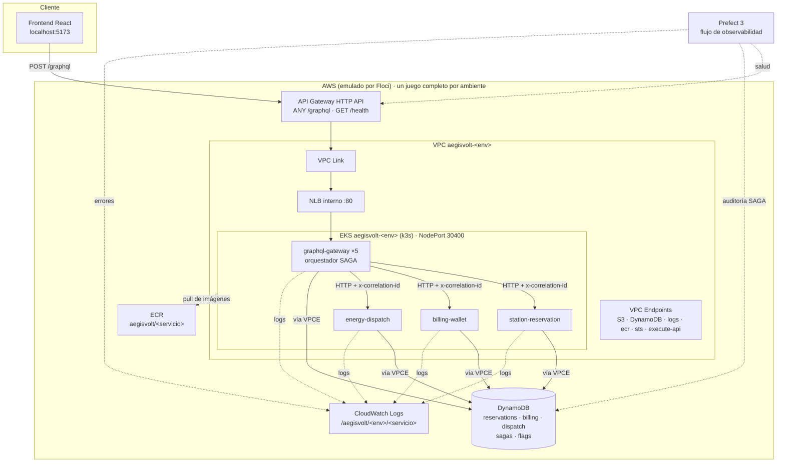
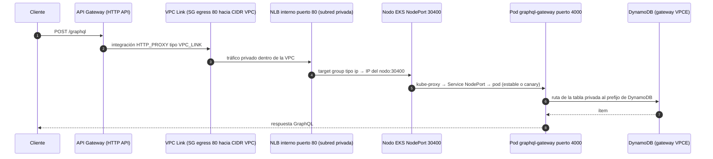
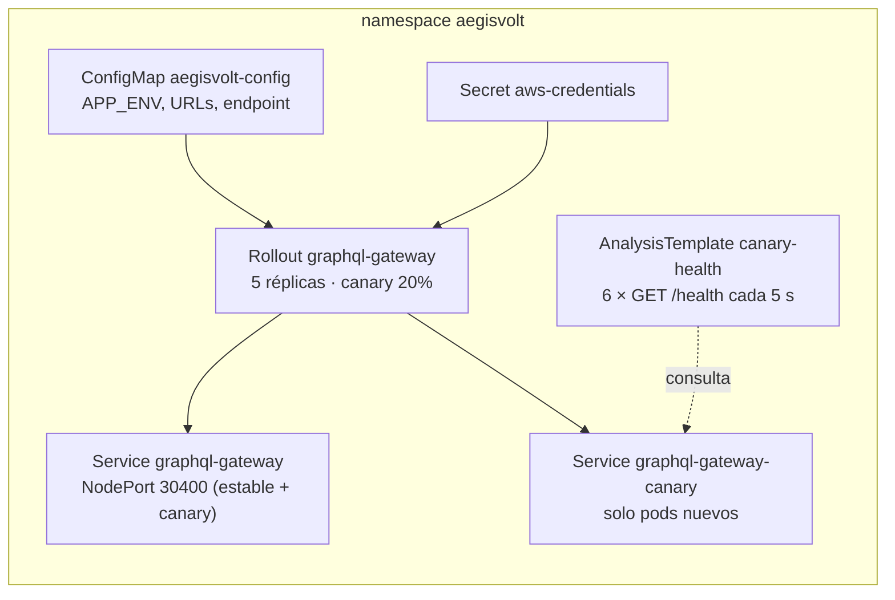

# Arquitectura

## Visión general

AegisVolt resuelve un problema de logística eléctrica: una flota necesita **reservar un conector, pagar y activar la carga** sin quedar a medias si algo falla (un cargador averiado, una billetera sin fondos). Las tres operaciones viven en servicios distintos con bases distintas, así que no hay transacción ACID: se coordinan con el **patrón SAGA por orquestación**.



## Componentes

| Componente | Responsabilidad | Puerto |
|---|---|---|
| `graphql-gateway` | Esquema GraphQL único. Orquesta la SAGA, guarda su bitácora en `sagas` y expone flags, estaciones, telemetría | 4000 |
| `station-reservation` | Disponibilidad de conectores. Paso 1 (reservar) y su compensación (liberar) | 4001 |
| `billing-wallet` | Billeteras de flota. Paso 2 (cobrar) y su compensación (reembolsar) | 4002 |
| `energy-dispatch` | Activación física del cargador y telemetría. Paso 3 (activar) | 4003 |
| `common/` | Logs JSON con `correlation_id`, cliente DynamoDB, flags, servidor HTTP mínimo, helper de idempotencia | — |

Los servicios no comparten base de datos (**database-per-service**): cada uno escribe solo en su tabla y se comunican únicamente por HTTP a través del orquestador.

### Esquema GraphQL

```graphql
type Query {
  env: String!                  # ambiente que atiende (dev | test | prod)
  stations: [Station!]!         # estaciones y estado de cada conector
  flags: [Flag!]!               # feature flags de este ambiente
  wallet(fleetId: ID!): Wallet
  sagas: [Saga!]!               # historial con pasos y compensaciones
  saga(id: ID!): Saga
  telemetry(sagaId: ID!): Telemetry
}
type Mutation {
  reserveAndCharge(stationId: ID!, connectorId: ID!, fleetId: ID!, kwh: Float!): Saga!   # dispara la SAGA
  finishCharge(sagaId: ID!): Saga!                                                       # fin normal de la carga
  setFlag(name: String!, enabled: Boolean!): Flag!                                       # cambio en caliente
}
```

## Red: recorrido de un paquete

Cada ambiente tiene su VPC (`10.10.0.0/16` dev, `10.20.0.0/16` test, `10.30.0.0/16` prod) con dos subredes públicas y dos privadas en dos zonas.

| Subred | CIDR (dev) | Tabla de rutas |
|---|---|---|
| públicas | `10.10.0.0/24`, `10.10.1.0/24` | `0.0.0.0/0 → Internet Gateway` |
| privadas | `10.10.10.0/24`, `10.10.11.0/24` | **sin ruta por defecto**: solo `local` + prefijos de S3/DynamoDB vía gateway endpoints |

El clúster EKS y el NLB viven en las subredes privadas. Como no hay NAT ni ruta a internet, **todo lo que sale de un pod hacia AWS pasa por un VPC Endpoint**:

- **Gateway endpoints** (S3, DynamoDB): agregan los prefijos del servicio a la tabla de rutas privada.
- **Interface endpoints** (`logs`, `execute-api`, `ecr.api`, `ecr.dkr`, `sts`): una ENI privada por subred con DNS privado, protegidas por el security group `aegisvolt-<env>-vpce` (entra solo 443 desde el CIDR de la VPC).



Qué interviene en cada salto:

1. **API Gateway → VPC Link**: la ruta `ANY /graphql` tiene integración `HTTP_PROXY` con `connection_type = VPC_LINK`, apuntando al listener del NLB. API Gateway nunca ve una IP pública.
2. **VPC Link**: security group con salida solo al puerto 80 y solo hacia el CIDR de la VPC.
3. **NLB → nodo**: target group TCP de tipo `ip`. `scripts/deploy.sh` registra la IP del nodo con el puerto 30400, con health check HTTP `/health`.
4. **Nodo → pod**: el Service `graphql-gateway` (NodePort 30400) selecciona pods estables y canary. Así el reparto de tráfico sale de la proporción de réplicas.
5. **Pod → DynamoDB/CloudWatch**: por los VPC Endpoints. En los pods, `AWS_ENDPOINT_URL` apunta a `10.<x>.0.2:4566`, que en Floci es la IP del endpoint dentro de la VPC del ambiente.

## Datos

| Tabla | Clave | Contenido |
|---|---|---|
| `aegisvolt-reservations-<env>` | `pk`, `sk` | `STATION#<id>` / `CONNECTOR#<id>` (status, powerKw, ultra, sagaId) + marcadores `SAGA#<id>` / `RESERVE`, `RELEASE` |
| `aegisvolt-billing-<env>` | `pk`, `sk` | `WALLET#<fleet>` / `BALANCE` + marcadores `SAGA#<id>` / `CHARGE`, `REFUND` |
| `aegisvolt-dispatch-<env>` | `pk`, `sk` | `SAGA#<id>` / `SESSION` (status CHARGING/FAULT/STOPPED, powerKw, startedAt) |
| `aegisvolt-sagas-<env>` | `id` | Bitácora de cada SAGA: estado, pasos con hora y error, monto |
| `aegisvolt-flags-<env>` | `name` | `enabled` por flag |

Los **marcadores** (`SAGA#<id>` + paso) se escriben en la misma transacción que el efecto, con `attribute_not_exists`. Son la base de la idempotencia (ver [SAGA](saga.md)).

### Feature flags

| Flag | dev | test | prod | Efecto |
|---|---|---|---|---|
| `ENABLE_DYNAMIC_SURGE_PRICING` | on | on | **off** | Cobro ×1.5 en hora pico |
| `ENABLE_FAST_CHARGE_BOOST` | on | on | **off** | Permite reservar conectores de ≥150 kW |
| `SIMULATE_CHARGER_HARDWARE_FAULT` | off | off | off | El cargador falla al activar: fuerza la compensación |

Se leen **en cada petición** (sin caché), así que un `setFlag` o un cambio en la tabla aplica al instante, solo en ese ambiente y sin redesplegar. Terraform siembra el valor inicial con `ignore_changes`, así que un `apply` posterior no pisa lo que se cambió en caliente.

## Kubernetes



- Cada servicio es un **Argo Rollout** con su Service estable y su Service `-canary`.
- **Kustomize**: `k8s/base` tiene lo común; `k8s/overlays/<env>` cambia `APP_ENV` y el endpoint de AWS de esa VPC. `deploy.sh` genera un overlay temporal con el tag de imagen.
- Imágenes: se suben a ECR (`localhost:5100/...`) y el nodo las baja por el mirror `000000000000.dkr.ecr.us-east-1.localhost:4566/...`.

## Decisiones de diseño

| Decisión | Por qué |
|---|---|
| SAGA por **orquestación** (no coreografía) | Un solo lugar define el orden y las compensaciones; la bitácora en `sagas` hace la auditoría trivial |
| Flags en **DynamoDB propio** | Una tabla por ambiente: aislamiento natural y cero dependencias extra |
| **Argo Rollouts** para el canary | Pasos declarativos (20% → análisis → 100%) y rollback automático si el análisis falla |
| **Node ejecutando TypeScript directo** | Sin paso de build: la imagen es el código fuente con dependencias de producción |
| **Floci** en lugar de AWS real | Mismo Terraform y mismas APIs, costo cero y todo reproducible en un PC |
| Runner **self-hosted** | El CI necesita llegar a Floci y al Docker local |

## Atajos conocidos

Cada atajo está marcado en el código con un comentario `shortcut:` que dice su límite y cuándo cambiarlo.

| Dónde | Atajo | En AWS real |
|---|---|---|
| `infra/modules/eks` | Sin `aws_eks_node_group`: Floci no lo emula y el nodo k3s ya ejecuta pods | Agregar node group |
| `k8s/base/*.yaml` | 1 réplica en los servicios internos (RAM del PC): su canary queda 50/50 | 5 réplicas |
| `k8s/base/kustomization.yaml` | Credenciales de prueba en un Secret | IRSA (rol IAM por service account) |
| `services/common` | Logs enviados desde la app en lotes de 1 s, sin Fluent Bit | DaemonSet de Fluent Bit / CloudWatch agent |
| `frontend/src/api.ts` | Coordenadas de las estaciones en el frontend | Mover lat/lng a DynamoDB |
