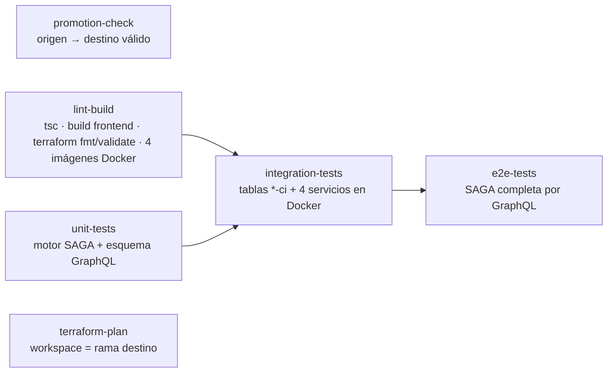
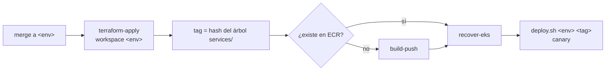
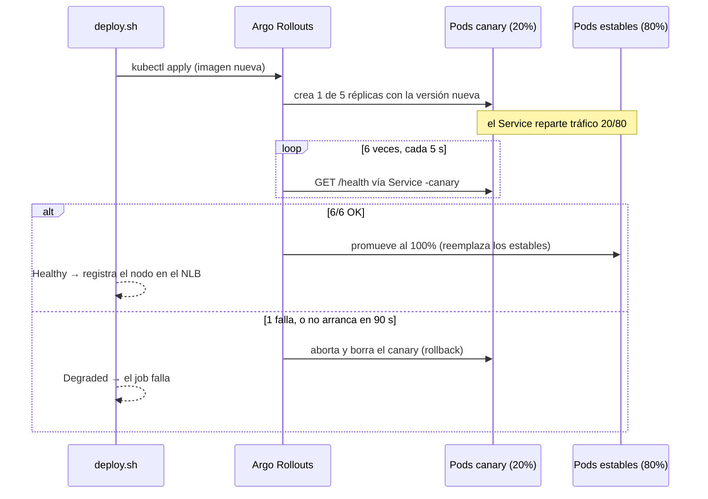

# CI/CD, ramas y promoción

## Ramas y promoción

`dev`, `test` y `prod` corresponden a los tres ambientes. Los cambios entran por `feature/*` y se promueven en cadena lineal, siempre por Pull Request:

```mermaid
gitGraph
  commit id: "base"
  branch dev
  checkout dev
  commit id: "dev"
  branch feature/frontend
  checkout feature/frontend
  commit id: "trabajo"
  checkout dev
  merge feature/frontend id: "PR → dev · deploy dev"
  branch test
  checkout test
  merge dev id: "PR dev → test · deploy test"
  branch prod
  checkout prod
  merge test id: "PR test → prod · deploy prod"
```

- Nunca una feature directo a `test` o `prod`, ni promoción hacia atrás. Lo valida el job `promotion-check`:

| Destino | Origen permitido |
|---|---|
| `dev` | cualquiera excepto `test` / `prod` |
| `test` | solo `dev` |
| `prod` | solo `test` |

## Protección de ramas

Ruleset de GitHub `proteger-ambientes` (`.github/rulesets/ambientes.json`) sobre `dev`, `test` y `prod`, **sin excepciones** (ni el dueño del repo puede saltarlo):

| Regla | Efecto |
|---|---|
| `non_fast_forward` | prohíbe `git push --force` |
| `deletion` | prohíbe borrar la rama |
| `pull_request` | prohíbe el push directo: todo entra por PR |
| `required_status_checks` | los 6 checks de CI deben estar en verde para habilitar el merge |

Intento de push directo:

```text
$ git push origin feature/x:test
remote: - Changes must be made through a pull request.
remote: - 6 of 6 required status checks are expected.
 ! [remote rejected] feature/x -> test (push declined due to repository rule violations)
```

## Pipeline pre-merge (`.github/workflows/ci.yml`)

Se dispara en cada PR hacia `dev`, `test` o `prod`:



- **terraform-plan** selecciona el workspace de la **rama destino** (`github.base_ref`) y deja el resumen del plan en la página del run. Falla solo si el plan da error.
- **integration / e2e** levantan tablas efímeras `*-ci` con Terraform y los 4 servicios con `docker compose`. Al final destruyen todo, aunque la prueba falle.

## Pipeline post-merge (`.github/workflows/deploy.yml`)

Se dispara con el push que deja el merge en `dev`, `test` o `prod`. **La rama decide el ambiente**:

```yaml
env:
  ENVIRONMENT: ${{ github.ref_name }}     # dev | test | prod
...
terraform workspace select "$ENVIRONMENT"
terraform apply -auto-approve
```



- **Mismo artefacto en todos los ambientes**: el tag de imagen es `git rev-parse --short=12 HEAD:services`, el hash del **contenido** de `services/`. Un merge a test crea un commit nuevo pero con el mismo árbol, así que se despliega exactamente la imagen ya probada en dev, sin reconstruir.
- `concurrency: deploy-<rama>`: un despliegue a la vez por ambiente, sin cancelar uno a medias.

## Canary deployment

Cada servicio es un `Rollout` de Argo:

```yaml
strategy:
  canary:
    canaryService: graphql-gateway-canary
    steps:
      - setWeight: 20                 # 1 de 5 pods con la versión nueva
      - analysis:
          templates: [{ templateName: canary-health }]
progressDeadlineSeconds: 90
progressDeadlineAbort: true
```



**Métrica de promoción** (AnalysisTemplate `canary-health`): 6 consultas a `/health` de los pods canary, cada 5 s. `successCondition: result.ok == true`, `failureLimit: 0` (un solo fallo aborta) y `progressDeadlineSeconds: 90`: si el canary ni siquiera arranca (imagen rota, crash loop), se aborta solo.

El reparto 20/80 se logra por **proporción de réplicas** (canary básico, sin service mesh): el gateway tiene 5 réplicas, así que un pod nuevo = 20%.

## Runner self-hosted

El CI necesita llegar a Floci (`localhost:4566`) y al Docker local, así que corre en un runner propio: `C:\actions-runner`, etiqueta `aegisvolt`.

```powershell
powershell -File scripts/start-runner.ps1   # arranca el runner (pone Git Bash primero en el PATH)
```
