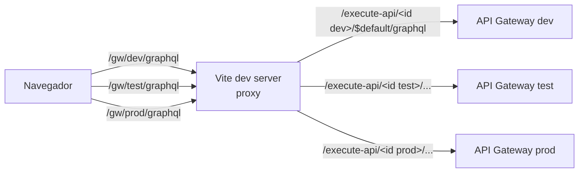

# Frontend

React 19 + Vite, sin librería de componentes: CSS propio con una paleta oscura de vidrio esmerilado, números finos y acentos verde (ok), ámbar (en uso / compensado) y rojo (falla). Cada estado lleva siempre ícono y texto, nunca solo color.

```bash
cd frontend && npm install && npm run dev   # http://localhost:5173
```

## Conexión a cada ambiente



Al arrancar, `vite.config.ts` lista las APIs de Floci (`aws apigatewayv2 get-apis`) y arma un proxy por ambiente. Así el frontend siempre llega a la API Gateway real de cada ambiente, aunque los ids cambien al recrear la infraestructura, y sin problemas de CORS.

El selector de ambiente (la regla del hero o los botones de la consola) cambia todo el tablero a ese ambiente. El punto de color indica si su `/health` responde.

## Tiempo real

Polling, simple y suficiente para la escala del proyecto:

| Qué | Cada |
|---|---|
| Estaciones, flags, SAGAs y billeteras (una sola query GraphQL) | 2 s |
| Salud de los 3 ambientes | 5 s |
| Telemetría de la sesión activa | 1.5 s |

## Pantallas

| Sección | Requisito que cubre |
|---|---|
| **Mapa en vivo**: estaciones con anillo de estado, conectores libres / en uso | Panel de estaciones y disponibilidad en tiempo real |
| **Reservar y cargar** (al elegir una estación): conector, flota, kWh, precio estimado con precio dinámico, pasos de la SAGA al terminar | Flujo de reserva y activación (dispara la SAGA) |
| **Feature flags**: interruptores del ambiente seleccionado | Visualizador de flags por ambiente, con cambio en caliente |
| **Compensaciones**: SAGAs revertidas con causa, pasos y comando de rastreo | Estado de compensaciones en caso de fallos |
| **Historial de transacciones**: tabla con pasos R/C/A coloreados y detalle | Historial de transacciones |
| **Telemetría en vivo**: kWh entregados, potencia, cobro y botón para finalizar | Telemetría de consumo |
| Éxito de transacciones y flotas | Contexto operativo |

## Cómo se ve una flag en la UI

- **Ultra-carga apagada** → el conector de 150 kW aparece bloqueado ("Ultra apagada") y no se puede elegir.
- **Precio dinámico** → el total estimado muestra "pico ×1.5".
- **Falla física simulada** → la siguiente reserva termina en `COMPENSATED`: aparece en el panel de compensaciones con el reembolso y la liberación.

Como cada ambiente tiene su propia tabla de flags, cambiar una en `dev` no afecta lo que muestra `prod`.

## Mapa

MapLibre GL con fuentes gratuitas y sin API key: imagen satelital de Esri (desaturada), relieve oscuro de Esri y vías de OpenFreeMap en blanco. Las estaciones están en Bogotá (Usaquén y Kennedy).

## Archivos

```
src/api.ts        cliente GraphQL por ambiente, tipos, metadatos de estaciones y flags
src/useLive.ts    hooks de polling (estado y salud)
src/Hero.tsx      hero: estelas animadas en canvas + regla de ambiente
src/MapView.tsx   mapa y marcadores
src/panels.tsx    reserva, compensaciones, flags, historial, telemetría, flotas
src/ui.tsx        números, estados, arte de línea, gráfica de éxito
src/styles.css    tema
```
