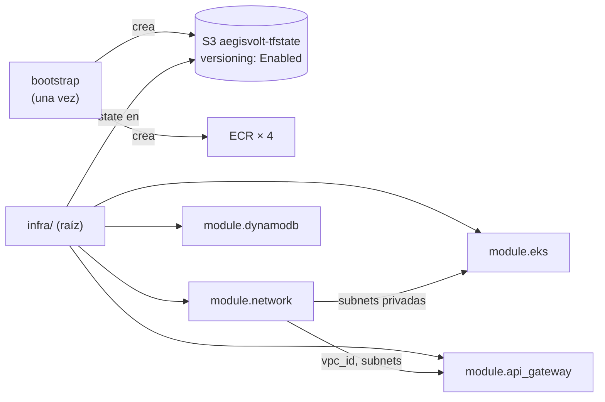

# Infraestructura como código

Todo se declara en Terraform; nada se crea a mano. El proveedor `aws` apunta a Floci (`http://localhost:4566`), que implementa las APIs de AWS en local.

## Estructura

```
infra/
├── bootstrap/        state local · bucket aegisvolt-tfstate (versionado) + repos ECR. Se aplica una sola vez.
├── providers.tf      backend S3 + provider aws con endpoints de Floci
├── main.tf           workspace guard, módulos y log groups
├── modules/
│   ├── network/      VPC, subredes, tablas de rutas, IGW, VPC endpoints
│   ├── dynamodb/     5 tablas por ambiente + datos semilla (conectores, billeteras, flags)
│   ├── eks/          rol IAM + aws_eks_cluster en subredes privadas, endpoint solo privado
│   └── api_gateway/  NLB interno, target group, VPC Link, HTTP API, rutas y stage
└── ci/               tablas *-ci efímeras para integración/e2e (state local)
```



## Ambientes = workspaces

```bash
cd infra
terraform workspace select dev    # o test / prod
terraform plan
terraform apply
```

Todo recurso toma su nombre de `terraform.workspace` (`local.env`):

- Tablas: `aegisvolt-reservations-dev`, `aegisvolt-billing-test`, `aegisvolt-dispatch-prod`…
- VPC `aegisvolt-<env>` con CIDR propio: dev `10.10/16`, test `10.20/16`, prod `10.30/16`.
- Clúster `aegisvolt-<env>`, API `aegisvolt-<env>`, log groups `/aegisvolt/<env>/<servicio>`.
- Flags con valor inicial por ambiente (`surge` y `boost` apagadas en prod).

**Guardia**: `terraform_data.workspace_guard` tiene una `precondition` que falla si el workspace no es `dev`, `test` o `prod`. Un `apply` desde el workspace `default` se detiene antes de tocar nada.

> **¿Por qué un `apply` en test no puede pisar prod?** Cada workspace tiene **su propio archivo de state** (`env:/test/aegisvolt.tfstate` vs `env:/prod/aegisvolt.tfstate`). Terraform solo conoce y modifica los recursos registrados en el state del workspace activo, y todos los nombres llevan el ambiente, así que no hay recursos compartidos que puedan colisionar.

## State remoto en S3

```hcl
backend "s3" {
  bucket       = "aegisvolt-tfstate"
  key          = "aegisvolt.tfstate"   # con workspaces queda env:/<ws>/aegisvolt.tfstate
  use_lockfile = true                 # lock nativo en S3 (sin tabla DynamoDB de locks)
}
```

- El bucket tiene **Versioning Enabled** y `prevent_destroy`: cada `apply` crea una versión nueva y las anteriores quedan como backup.
- El lock (`.tflock`) evita que dos `apply` del mismo ambiente corran a la vez (por ejemplo, el pipeline y una persona).

### Ver las versiones del state

```bash
export AWS_ENDPOINT_URL=http://localhost:4566 AWS_ACCESS_KEY_ID=test AWS_SECRET_ACCESS_KEY=test AWS_DEFAULT_REGION=us-east-1
MSYS_NO_PATHCONV=1 aws s3api list-object-versions --bucket aegisvolt-tfstate --prefix env:/dev/ \
  --query 'Versions[].[VersionId,LastModified,IsLatest]' --output table
```

### Restaurar una versión anterior (state corrupto)

1. Elegir la versión buena de la lista anterior (`VersionId`).
2. Copiarla sobre sí misma: se convierte en la versión más reciente y la corrupta queda como una versión más, sin perder nada.

```bash
MSYS_NO_PATHCONV=1 aws s3api copy-object --bucket aegisvolt-tfstate \
  --key env:/dev/aegisvolt.tfstate \
  --copy-source "aegisvolt-tfstate/env:/dev/aegisvolt.tfstate?versionId=<VersionId>"
```

3. Verificar con `terraform plan` en el workspace `dev`: debe mostrar solo las diferencias reales entre ese state y la infraestructura.

## Módulos

### network

VPC con DNS, 2 subredes públicas (IGW) y 2 privadas **sin NAT**. Gateway endpoints S3/DynamoDB en la tabla privada e interface endpoints `logs`, `execute-api`, `ecr.api`, `ecr.dkr`, `sts` con DNS privado. Detalle del recorrido en [Arquitectura](arquitectura.md#red-recorrido-de-un-paquete).

### dynamodb

Tablas `PAY_PER_REQUEST`. Semillas: 4 conectores (`st-norte/c2` es ultra de 150 kW), 2 billeteras (`fleet-andina` 500, `fleet-sin-saldo` 5) y las 3 flags. Las semillas usan `ignore_changes = [item]`: el estado que cambia en ejecución (saldos, conectores, flags) no se resetea en el siguiente `apply`.

### eks

`aws_eks_cluster` en las subredes privadas con `endpoint_public_access = false`. Floci lo materializa como un contenedor **k3s** (Kubernetes real) conectado a la red Docker de esa VPC. `scripts/kubeconfig.sh <env>` arma el kubeconfig desde el contenedor.

### api_gateway

NLB interno → target group TCP tipo `ip` (puerto 30400, health check `/health`) → VPC Link → HTTP API con rutas `ANY /graphql` y `GET /health`, stage `$default` con auto-deploy.

## Tablas de CI

`infra/ci` reutiliza el **mismo módulo** `dynamodb` con `env = "ci"`. Los jobs de integración y e2e lo aplican antes de probar y lo destruyen al final, así las pruebas nunca tocan datos de dev/test/prod.
