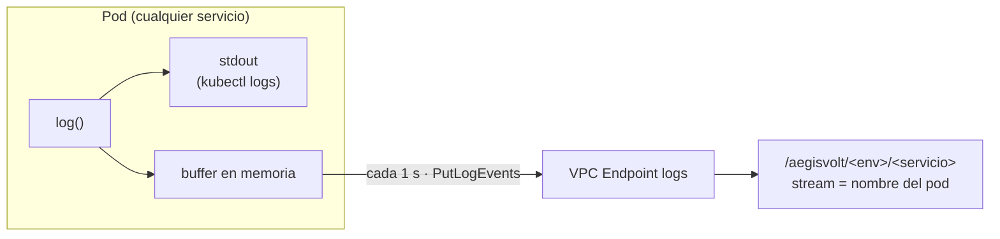
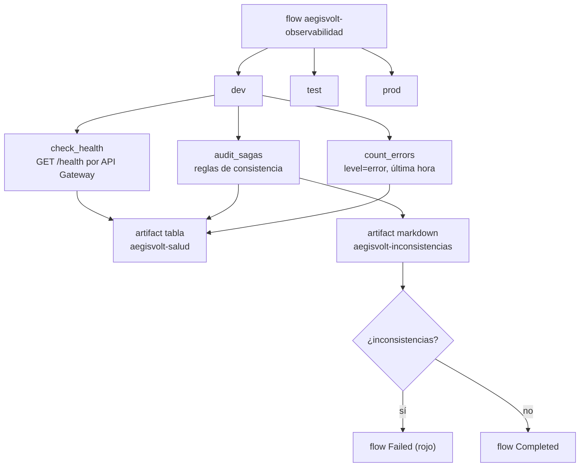

# Observabilidad

## Logs estructurados en CloudWatch

Cada línea de log es un JSON con ambiente, servicio y el `correlation_id` de la SAGA (que es su id):

```json
{"timestamp":"2026-11-09T01:26:25.793Z","level":"warn","env":"dev","service":"billing-wallet",
 "msg":"fondos insuficientes en fleet-sin-saldo para cobrar 36","status":402,"path":"/charges",
 "correlation_id":"c0669bbd-9492-43f7-997d-1f763cab4b09"}
```



- **Grupos por ambiente y servicio**: `/aegisvolt/dev/graphql-gateway`, `/aegisvolt/test/billing-wallet`… Los crea Terraform con retención de 14 días.
- **Un stream por pod** (`HOSTNAME`): se distingue qué réplica, estable o canary, escribió cada línea.
- Si el grupo no existe (CI, tests locales), el servicio sigue logueando solo a stdout.

### Rastrear una SAGA

```bash
bash scripts/trace-saga.sh dev <sagaId>
```

Busca el id en todos los grupos `/aegisvolt/dev/*` y ordena por tiempo:

```text
graphql-gateway      SAGA iniciada
station-reservation  conector reservado
billing-wallet       fondos insuficientes en fleet-sin-saldo para cobrar 36   (402)
station-reservation  conector liberado
graphql-gateway      SAGA COMPENSATED
```

El id de una SAGA fallida se obtiene del historial del frontend (columna SAGA) o del panel de compensaciones, que ya muestra el comando listo para copiar.

## Prefect

`observability/flow.py` define el flujo **`aegisvolt-observabilidad`**. Por cada ambiente corre tres tareas en paralelo:



### Reglas de auditoría SAGA

| Inconsistencia | Cómo se detecta |
|---|---|
| SAGA huérfana | `RUNNING` hace más de 2 minutos (una SAGA real tarda menos de 1 s: el orquestador murió a mitad) |
| Compensación fallida | estado `COMPENSATION_FAILED` |
| Cobro sin reembolso | SAGA compensada con marcador `CHARGE` y sin `REFUND` en billing |
| Conector bloqueado | conector `RESERVED` cuya SAGA no está `RUNNING` ni `COMPLETED` |

Las reglas son una función pura (`find_inconsistencies`) con su self-check: `python observability/test_flow.py`.

Un ambiente caído se reporta como `DOWN` en la tabla, pero **no** hace fallar el flujo. Solo lo hacen las inconsistencias de datos, que son las que requieren acción.

### Ejecutar

```bash
cd observability
python -m venv .venv && .venv/Scripts/pip install -r requirements.txt   # una vez
.venv/Scripts/prefect server start                                      # dashboard en http://127.0.0.1:4200
# en otra terminal:
PREFECT_API_URL=http://127.0.0.1:4200/api .venv/Scripts/python flow.py           # una ejecución
PREFECT_API_URL=http://127.0.0.1:4200/api .venv/Scripts/python flow.py --serve   # deployment cada 5 min
```

En el dashboard: **Runs** muestra cada ejecución (verde/rojo) y **Artifacts** muestra la tabla de salud y la lista de inconsistencias.

### Demo de una huérfana

```bash
bash scripts/chaos-orphan.sh dev          # simula un orquestador muerto a mitad de una SAGA
# correr el flujo → Failed, la tabla marca 1 inconsistencia en dev
bash scripts/chaos-orphan.sh dev --clean  # la marca COMPENSATED (no aplicó ningún paso)
```

El registro queda marcado con `simulated: true` para distinguirlo de datos reales.
