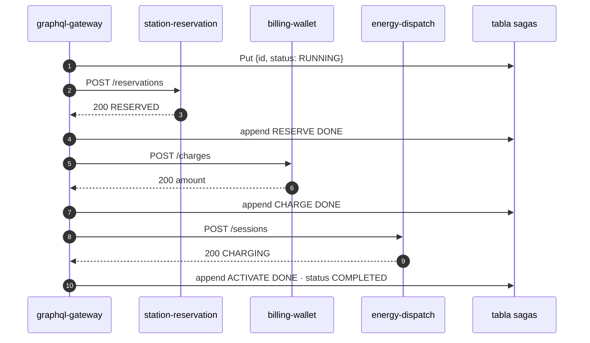
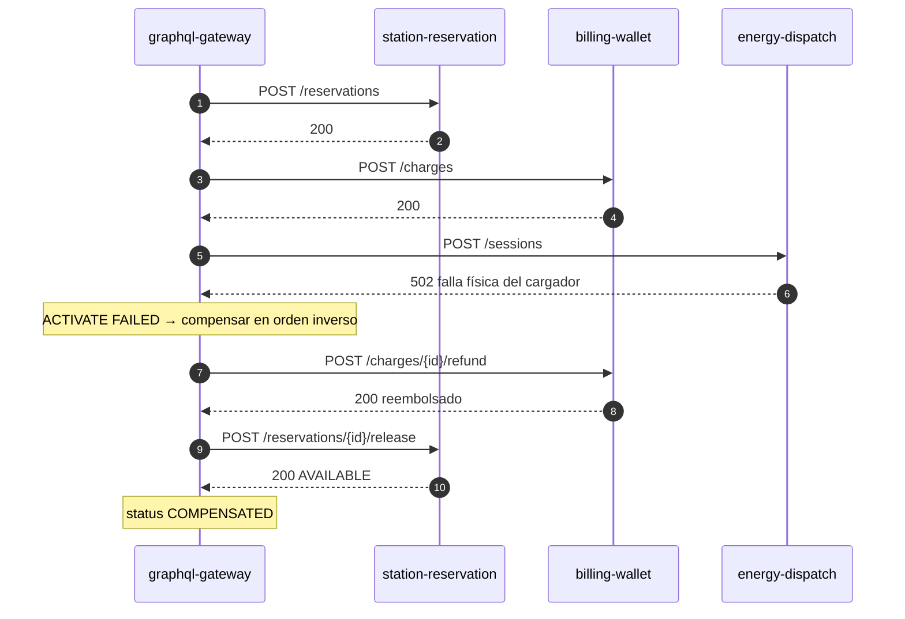
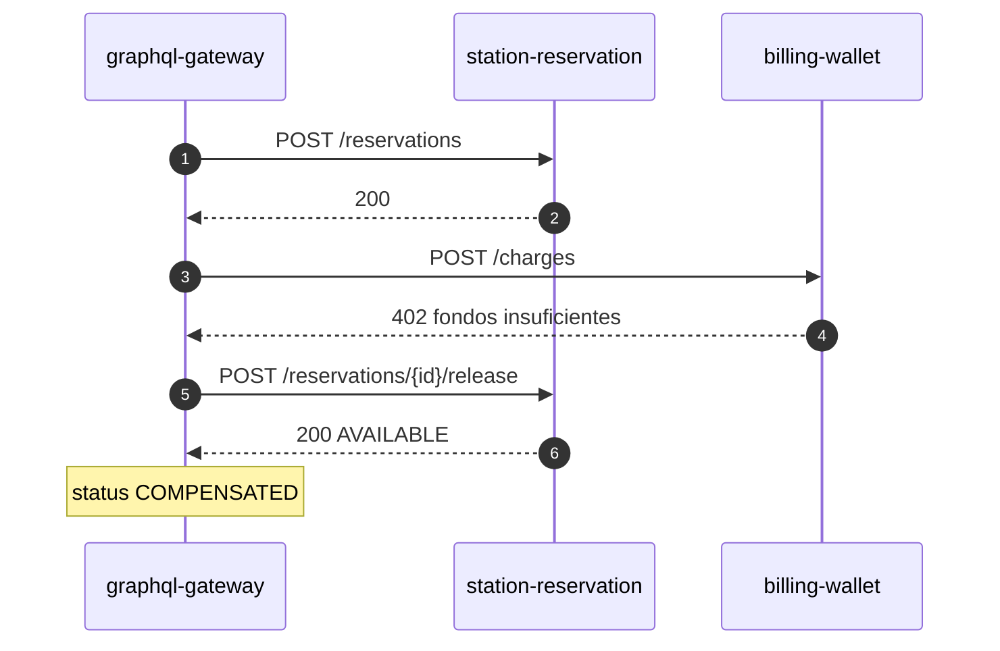
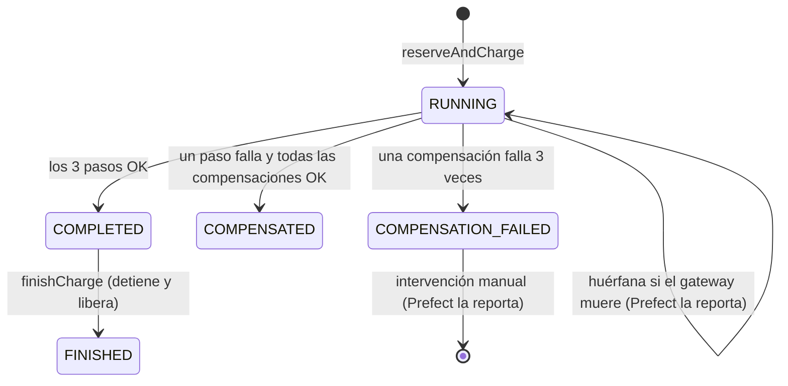

# SAGA "Reservar y activar carga"

La mutación `reserveAndCharge` ejecuta tres pasos locales en tres servicios. No hay transacción global: si un paso falla, el orquestador (`graphql-gateway`) **deshace los pasos anteriores en orden inverso** con transacciones compensatorias.

Código: `services/graphql-gateway/saga.ts` (motor genérico) e `index.ts` (definición de los pasos).

| # | Paso | Servicio | Efecto | Compensación |
|---|---|---|---|---|
| 1 | `RESERVE` | station-reservation | conector `AVAILABLE → RESERVED` | liberar → `AVAILABLE` |
| 2 | `CHARGE` | billing-wallet | descuenta `kWh × 1.2 × (surge ? 1.5 : 1)` | reembolsar |
| 3 | `ACTIVATE` | energy-dispatch | inicia la sesión `CHARGING` | — (es el último paso) |

## Camino feliz



## Falla en el paso 3 (cargador averiado)

Con la flag `SIMULATE_CHARGER_HARDWARE_FAULT` encendida, `energy-dispatch` responde **502**. Se reembolsa el cobro y después se libera el conector:



## Falla en el paso 2 (sin fondos)

`billing-wallet` responde **402**. Un 4xx es un rechazo seguro (no se cobró nada), así que solo se libera el conector:



## Estados de una SAGA



## Reglas del motor

1. **Orden inverso**: se compensa del último paso aplicado al primero.
2. **¿Se compensa el paso que falló?** Depende de si se sabe que no se aplicó:
   - **4xx** → rechazo seguro: no se compensa ese paso.
   - **5xx o timeout** → resultado incierto (pudo aplicarse y perderse la respuesta): **sí** se compensa. Es seguro porque las compensaciones son idempotentes y no hacen nada si no hubo efecto.
3. **Reintentos**: cada compensación se intenta 3 veces. Si sigue fallando, la SAGA queda en `COMPENSATION_FAILED` y Prefect la reporta.
4. **Bitácora**: cada evento (`DONE`, `FAILED`, `COMPENSATED`, `COMPENSATION_FAILED`) se agrega a `steps` con hora y error. El historial del frontend se dibuja desde ahí.
5. **Trazabilidad**: el id de la SAGA es el `correlation_id`. Viaja en el header `x-correlation-id` y aparece en todos los logs de los cuatro servicios.

## Idempotencia

> ¿Qué pasa si una petición o compensación llega dos veces?

Cada efecto se escribe **en la misma transacción DynamoDB** que un marcador con condición `attribute_not_exists`:

```
TransactWriteItems [
  Update  WALLET#fleet-andina / BALANCE   SET balance = balance - :amount   IF balance >= :amount
  Put     SAGA#<id> / CHARGE              {amount, at}                      IF attribute_not_exists(pk)
]
```

- **Primera vez**: ambas escrituras se aplican juntas o ninguna.
- **Duplicado**: el `Put` del marcador falla por la condición, así que la transacción entera se cancela y el saldo no se toca. El servicio lee el marcador existente y **devuelve el resultado original** (`cobro duplicado ignorado`).
- **Regla de negocio violada** (sin fondos, conector ocupado): la transacción falla pero el marcador **no** existe, así que es un error real (402 / 409).

Lo mismo aplica a `RESERVE`/`RELEASE`, `CHARGE`/`REFUND` y `SESSION`. Lo implementa `idempotent()` en `services/common/index.ts`, y lo prueban `services/integration/services.int.ts` (doble cobro, doble reserva) y `services/e2e/saga.e2e.ts` (reembolso repetido).

## Pruebas

| Nivel | Archivo | Qué prueba |
|---|---|---|
| Unit | `graphql-gateway/saga.test.ts` | Camino feliz, falla en paso 2, falla en paso 3 con orden de compensación, timeout que compensa el paso incierto, `COMPENSATION_FAILED` |
| Integración | `integration/services.int.ts` | Idempotencia real contra DynamoDB: reserva doble, 409, cobro doble, 402, flag leída en vivo |
| E2E | `e2e/saga.e2e.ts` | Por GraphQL: feliz + `finishCharge`, flota sin saldo, falla física + reembolso idempotente |
